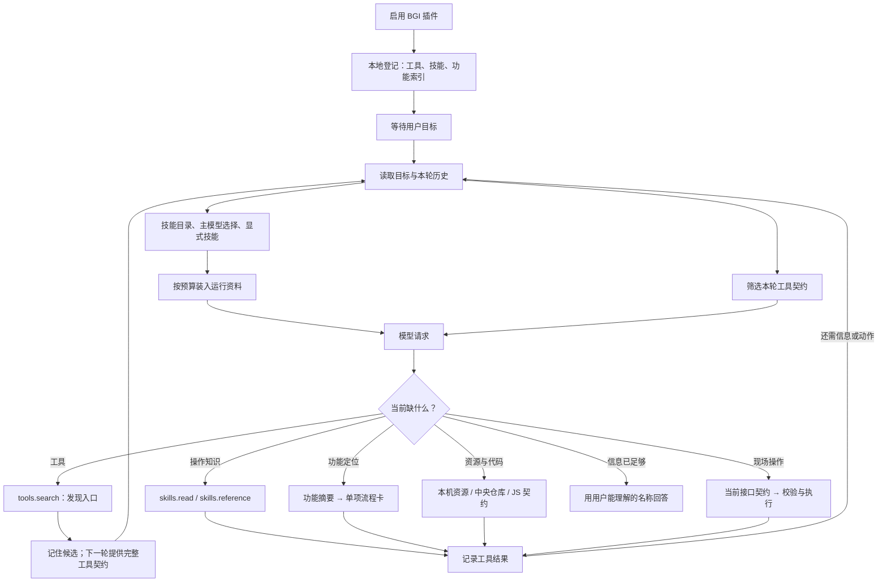
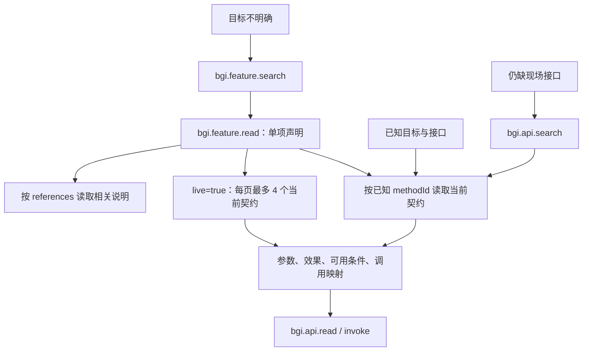

# BGI 当前渐进式披露链路

本文按当前仓库源码整理，核对日期：2026-10-25。描述现有实现，节点说明只保留用途、披露内容和去向。

阅读时区分三件事：**本地已登记、模型本轮可见、当前允许执行**。插件可以已登记全部工具和索引，而模型只看到其中一部分；发现工具也不扩大用户授权。

## 1. 总图



这是一个主模型循环中的多条资料路径。模型选择技能与程序筛选工具分别进行；已知资源、文件或接口可以直接定位，不要求先走完功能搜索。

## 2. 启动与本地登记

这一段由程序完成，不需要模型逐个调用。

| 节点 | 简化说明 | 产出 / 下一步 |
| --- | --- | --- |
| 插件清单 | 读取 BGI 的技能目录和 MCP 服务配置。 | `plugins/bgi/.sleepy-doll-plugin/plugin.json`。 |
| 进程内 MCP 服务 | 在应用内提供 BGI 工具服务。 | 服务 ID 为 `bridge`，提供方为 `bgi`。 |
| MCP 初始化说明 | 取得服务的简短操作规则。 | 登记为 `mcp-bgi-bridge` 技能。 |
| MCP 工具清单 | 分页读取 `tools/list`，取得完整工具契约。 | 当前登记 21 个 BGI 模型工具。 |
| 内部连接工具 | 为执行器提供请求和事件通道。 | `bgi.host.request/events` 不进入模型工具清单。 |
| 技能登记 | 读取三个文件技能的目录信息及正文。 | 本地可查，正文按条件送给模型。 |
| 功能索引 | 加载随程序编译的离线功能卡。 | 搜索只输出少量摘要。 |

BGI 的 MCP 工具是外层入口。大量宿主方法藏在 `bgi.api.read/invoke` 的 `methodId` 后面，并未变成成千上万个独立模型工具。

## 3. 每轮请求前如何披露

| 节点 | 简化说明 | 规则 |
| --- | --- | --- |
| 核心指令 | 提供通用行为、证据和回复规则。 | 不装入 BGI 全套手册。 |
| 技能目录 | 给出可用技能的名称和一句简介。 | 先过滤停用项及环境条件。 |
| 按需读取 | 主模型依据简介选择技能。 | skills.read 读取正文，skills.reference 读取相关资料；不按关键词自动装入子技能。 |
| 显式技能 | 识别用户写出的 `$技能名`。 | 选中后进入待装载正文集合。 |
| 插件参与判断 | 判断当前任务是否涉及 BGI。 | 用户显式指定 BGI 技能，或发现、使用 BGI 工具，都会使其参与。 |
| 插件常驻说明 | 加载 `bgi-assistant` 和 MCP 简短规则。 | 只在 BGI 已参与时加入，不随普通问候全部加载。 |
| 正文预算 | 优先放入重要说明，超预算时跳过整项。 | 列出未载入的资料名，不假装正文已读。 |
| 资料版本 | 相同内容不重复追加；变化时追加新版本。 | 保留稳定核心指令，资料作为运行上下文。 |
| 工具候选集 | 收集当前可供筛选的内核及插件定义。 | `deferred`、`always_load` 只参与这一层，不决定最终可见集合。 |
| 工具允许检查 | 根据权限、发现记录和读写证据判断可调用性。 | 只读模式、快捷入口模式等限制仍有效。 |
| 工具可见筛选 | 选出本次请求的完整工具定义。 | 发现过、用过、满足证据条件的工具继续提供。 |
| 稳定排序 | 按来源和名称排列工具。 | 不按随机注册顺序排列。 |

全新普通问候在没有发现、使用或解锁其他工具时，只提供 `tools.search`。如果目标已匹配 BGI 技能，技能正文仍可先出现；“只有一个工具”不等于“没有技能上下文”。

## 4. 工具发现与证据解锁


| 节点 | 简化说明 |
| --- | --- |
| 搜索范围 | 查已登记的工具名称、显示名、描述和检索提示。不是搜用户文件或宿主全部方法。 |
| 搜索结果 | 返回名称、显示名、最多 400 字描述、效果类别及 `contractExposed:true`。 |
| 契约进入请求 | 完整参数结构放入下一轮 `tools`，无需再为工具参数单独读一次说明。 |
| 已发现 | 搜索命中的候选都被记住，不只记住模型最终调用的一项。 |
| 已使用 | 本次运行历史里调用过的工具继续参与筛选；仍须通过允许检查。 |
| 读取证据 | 同一工具来源的成功、非空只读结果，能够解锁 `AfterRead` 工具。 |
| 写入证据 | 同一来源的成功、非空且非内部状态写入结果，能够解锁 `AfterWrite` 工具。 |
| 无效证据 | `tools.search` 自身、失败、空结果、未找到目标等不构成读取解锁证据。 |
| 解锁粒度 | 当前按工具来源解锁，不是按单个资源、配置项或宿主方法解锁。 |
| 显式发现 | 可直接发现后续读写工具，但执行时的权限、参数与资源版本检查仍要通过。 |

### 4.1 当前 21 个 BGI 工具

下面的 `Always` 表示允许规则中的入口类型，**不代表首轮自动把它展示给模型**；还需经过本轮可见筛选。所有工具也都可以经 `tools.search` 被发现。

| 工具 | 简化说明 | 默认披露条件 |
| --- | --- | --- |
| `bgi.state.get` | 看游戏、窗口及任务状态。 | `Always`。 |
| `bgi.user.resolve` | 找到用户要运行的本机资源；未命中再查仓库。 | `Always`。 |
| `bgi.user.list` | 看指定目录的一层资源，可附 JSON 摘要。 | `Always`。 |
| `bgi.user.read` | 读已知资源、配置或源码。 | `Always`。 |
| `bgi.repo.search` | 查中央仓库中的脚本和路线。 | `Always`。 |
| `bgi.repo.read` | 按路径读仓库文件，可搜索及分页。 | `Always`。 |
| `bgi.symbols.inspect` | 解析已知接口、类型与继承关系，无需连接宿主。 | `Always`。 |
| `bgi.feature.search` | 按目标查 BGI 功能摘要。 | `Always`。 |
| `bgi.feature.read` | 读取一项声明，可附当前接口契约。 | `Always`。 |
| `bgi.api.describe` | 读一个宿主方法的当前参数和调用规则。 | `Always`。 |
| `bgi.api.search` | 查运行中的宿主接口目录。 | `AfterRead`。 |
| `bgi.api.read` | 调用只读宿主方法。 | `AfterRead`。 |
| `bgi.api.invoke` | 调用有写入或执行效果的宿主方法。 | `AfterRead`。 |
| `bgi.user.inspect_script` | 合并读脚本说明、参数定义及账户配置。 | `AfterRead`。 |
| `bgi.user.write` | 按读取版本保存用户资源文件。 | `AfterRead`。 |
| `bgi.user.restore` | 从备份恢复指定用户资源文件。 | `AfterRead`。 |
| `bgi.job.get` | 查已有 Job 的结果。 | `AfterWrite`。 |
| `bgi.job.cancel` | 请求取消已有 Job。 | `AfterWrite`。 |
| `bgi.capability.search` | 查扩展登记的语义能力。 | `OnDemand`，须发现。 |
| `bgi.capability.describe` | 读扩展能力契约。 | `OnDemand`，须发现。 |
| `bgi.capability.invoke` | 执行已定位的扩展能力。 | `OnDemand`，须发现。 |

因此，当前并非“一次只给一个工具”：一次搜索可披露多个候选；一次有效读取后，也可能同时解锁同来源的多个后续工具。

## 5. 技能与参考资料链

```text
技能名称与简介
  ├─ 主模型 skills.read / $显式指定 → 按需读取正文
  └─ skills.search → 技能简介 → skills.read → 指定正文
技能正文 / 功能卡中的 references
  └─ skills.reference(name, path) → 指定参考文件全文
```

`skills.search` 当前返回技能元数据，不含正文；`skills.read` 返回指定正文及版本。`skills.reference` 读取技能目录内的一份文件，限制路径范围和文件大小，不递归展开其中的全部链接。这三个技能工具从首轮可见；读取和搜索一致检查停用项及环境依赖。

### 5.1 四份 BGI 技能说明

| 技能 | 简化内容 | 何时加载正文 |
| --- | --- | --- |
| `bgi-assistant` | 识别目标，分流资源、配置、脚本及故障。 | BGI 参与时的常驻入口，或主模型 skills.read、显式选择。 |
| `mcp-bgi-bridge` | 区分工具与宿主方法，说明启动、取消和结果边界。 | BGI 参与时的 MCP 常驻说明，或主模型 skills.read、显式选择。 |
| `bgi-operator` | 根据操作类型选择具体流程。 | 显式选择或主模型 `skills.read`。 |
| `bgi-javascript` | 从参数定义跟到脚本行为和真实 API。 | 显式选择或主模型 `skills.read`。 |

以上自动装载仍受技能环境条件和上下文预算限制。

### 5.2 `bgi-assistant` 的参考节点

路径均相对于 `plugins/bgi/skills/bgi-assistant/`。

| 参考文件 | 简化内容 |
| --- | --- |
| `references/user-goals.md` | 将日常口语目标分到实际功能域。 |
| `references/feature-map.md` | 查功能分区和页面入口。 |
| `references/source-routing.md` | 选择用户文档、宿主源码或脚本仓库。 |
| `references/guide-workflow.md` | 回答使用问题，分析配置与优化条件。 |
| `references/tool-workflow.md` | 查功能、读契约、执行和处理失败。 |
| `references/action-policy.md` | 授权范围、任务准备、启动与停止边界。 |
| `references/collection-workflow.md` | 查材料路线、订阅、组装、运行。 |
| `references/quick-tasks.md` | 把已有动作绑定为快捷入口。 |
| `references/troubleshooting.md` | 按现象和日志定位故障。 |
| `references/viewmodel-usage.md` | 区分可用页面能力与内部实现。 |
| `references/capability-boundaries.md` | 区分回答、查现成实现和制作脚本。 |
| `references/bgi-domain.md` | 解释一条龙、配置组、脚本、路线等对象。 |
| `references/sources.md` | 核对资料来源及更新时间。 |
| `references/integration.md` | 说明接入与能力目录设计。 |

这些文件是可按需读取的节点，不代表每次任务都会加载；接入说明和验收用例也不是普通任务的必经步骤。

### 5.3 `bgi-operator` 与 `bgi-javascript` 的参考节点

| 所属技能 | 参考文件 | 简化内容 |
| --- | --- | --- |
| `bgi-operator` | `references/resources.md` | 查改配置组和用户资源，区分运行参数层次。 |
| `bgi-operator` | `references/settings.md` | 读取、预览和提交全局设置事务。 |
| `bgi-operator` | `references/settings-recovery.md` | 按选项恢复历史设置，保留其他修改。 |
| `bgi-operator` | `references/execution.md` | 准备任务、检查就绪、运行及核验。 |
| `bgi-operator` | `references/repository.md` | 更新仓库、订阅和导入资源。 |
| `bgi-operator` | `references/script-analysis.md` | 排查脚本参数、源码及报错。 |
| `bgi-operator` | `references/native-ui.md` | 按真实界面字段、选项及窗口流程操作。 |
| `bgi-operator` | `references/shared.md` | 处理缺项、失败与面向用户的表达。 |
| `bgi-javascript` | `references/writing.md` | 查询当前 JS 契约，再编写和验证脚本。 |

## 6. 功能摘要 → 流程卡 → 当前契约



| 节点 | 简化说明 | 披露范围 |
| --- | --- | --- |
| 功能摘要 | 返回 ID、类型、标题、适用条件。 | 默认 5 项，每页最多 12 项；跟随 `nextOffset`。 |
| 源码声明 | 返回来源、结构化参数、返回类型、继承和成员分页，不预设步骤。 | 一次展开一个精确 ID。 |
| 现场展开 | 为卡片引用的方法取得当前契约。 | `live=true`，跟随 `nextMethodOffset`。 |
| 现场一致性 | 比较本页契约的实例与目录版本。 | 尚有后续页时，不把整张卡宣称为全部可执行。 |
| 接口检索 | 在当前宿主目录查方法候选。 | 默认 8 项，可按目录实际分组和分页继续。 |
| 单项契约 | 给出参数、效果、可用条件及 `agentCall` 映射。 | 精确到一个宿主方法。 |
| 执行前重取 | 实际调用时重新取得当前契约并校验。 | 不强制模型额外先调一次 `describe`。 |

静态卡中的 JS API 项只作编写脚本的参考。它不能因为显示了成员，就被当作可直接执行的桥操作。

### 6.1 当前功能索引的层次

当前共 4135 项。这些是本地索引条目数，不是单次请求的工具数。

| 类型 | 数量 | 简化内容 |
| --- | --- | --- |
| `command` | 278 | 宿主命令及操作入口。 |
| `setting` | 620 | 设置项及其读写链路。 |
| `page` | 1433 | 页面、窗口和相关可见能力。 |
| `scriptApi` | 1713 | JS 绑定与类型参考。 |
| `resourceModel` | 35 | 配置组、脚本、路线等资源结构。 |
| `stable` | 56 | 稳定的领域接口。 |

### 6.2 能力目录的来源

目录只包含源码中的命令、设置、页面绑定、JS 注入及成员、资源类型，以及托管桥实际 MethodRegistry 注册的接口。每项带来源；注册快照由 export-method-metadata.ps1 导出，不调用处理器。不存在预设用户问法、业务分类、流程模板或关键词场景表。

feature.search 对真实名称与说明做通用词项检索；保留中文词项、英文符号、驼峰和下划线边界，以文档频率排序，不按业务类型加分。空 query 可分页浏览；已知 ID 直接 feature.read。流程和参数含义由模型按需读取插件技能，再结合当前对象与契约处理。

## 7. 资源、脚本与扩展的分支

| 分支 | 当前节点顺序 | 每步简化内容 |
| --- | --- | --- |
| 运行已有资源 | `user.resolve → 准备或修复 → api.read/invoke` | 找本机目标；按缺项处理；调用当前运行接口。 |
| 本机未命中 | `user.resolve → 内部仓库搜索 → resourceFound / notFound / lookupFailed` | 查全仓资源；区分找到、未找到和查询失败。 |
| 读改配置组 | `user.list/read → 参数定义或有效配置 → user.write / 原生设置接口 → 回读` | 找真实对象；理解当前值；按版本写入；核对生效值。 |
| 本机脚本 | `user.inspect_script → user.read` | 一次拿说明、参数与账户；再读必要源码。 |
| 未订阅脚本 | `repo.search → repo.read → 引用模块` | 查精确仓库路径；读定义和入口；只追必要调用。 |
| 编写 JS | `skills.read → writing.md → api.describe/read(JS 搜索与读取方法)` | 读写作规则；查真实绑定；展开所需成员。 |
| 外部扩展能力 | `capability.search → describe → invoke → 必要时 job.get` | 查扩展；拿契约；执行；核验结果。 |
| 直接接口不适用 | `页面入口 → ui.read → ui.options/write/invoke → 回读` | 取得真实控件、选项和版本；完成原生流程；核对效果。 |

资源定位的 `run / inspect / repair / create` 等结论只决定接下来该查、修、建还是运行。它们不是已经执行的结果。

`bgi.api.search` 只查询当前接口目录，不自动改搜仓库。检索对象及资料来源由主模型依据技能和当前事实选择。

`bgi.js_api.search/read`、`bgi.ui.read/write`、设置事务及具体任务入口等，属于**宿主方法 ID**，通过外层 `bgi.api.read/invoke` 调用；它们不在前述 21 个模型工具里另占一个工具位置。

## 8. 执行与结果如何回到披露链

| 节点 | 简化说明 |
| --- | --- |
| 外层工具检查 | 核对本轮允许调用的工具及参数结构。 |
| 当前宿主契约 | 重新核对方法、参数、可用条件与效果类别。 |
| 目标与授权检查 | 对照用户目标、计划、权限及资源版本。 |
| 执行器 | 调用进程内 MCP 或原生桥；写操作按协议跟踪结果。 |
| 执行记录 | 保存工具调用与配对结果，供下一轮模型读取。 |
| 大结果 | 需要时保存完整观测或产物；通过 `observation.read / artifact.read` 分页补读。 |
| 下一轮资料 | 重新筛选工具和技能；相同资料版本不重复追加。 |
| 回复 | 用可见设置名称、实际值含义和结果回答；开发问题保留必要代码细节。 |

普通启动默认后台交接，运行时等待交接证据后结束；用户要求等结果或排障时才继续相关查询。模型无需为等待本身持续生成请求。

## 9. 当前实现的实际边界

| 项目 | 当前情况 |
| --- | --- |
| 是否一条固定顺序 | 否。已知路径、已知方法、现成资源可以走短链。 |
| 是否每次只披露一个工具 | 否。一次搜索最多披露 8 项，证据解锁也可同时开放多项。 |
| 是否每轮回收无关工具 | 没有做细粒度回收；本次运行已发现的工具会继续保留。 |
| 是否逐项精确解锁 | 当前读写解锁按工具来源；目标、参数和授权另行检查。 |
| 是否全文自动展开引用 | 否。参考文件、源码和具体成员由模型按需读取。 |
| 是否所有顺序都由程序强制 | 否。权限和契约检查是程序约束；选择资料源及优先直接接口主要由技能引导。 |
| 是否展示摘要就算执行 | 否。摘要、静态卡、当前可用契约、实际执行结果是四个阶段。 |
| 是否保证缓存命中 | 否。稳定排序与资料版本减少无意义变化；工具集合增长及模型服务策略仍影响命中。 |

## 10. 两条常见短链

以下是现有入口支持的典型走法，不是记录到的固定调用序列。已可见工具无需再次搜索。

```text
“运行已有锄地配置组”
  → 匹配 BGI 入口技能
  → tools.search 找资源定位入口
  → bgi.user.resolve
  → 仅处理真实缺项，必要时读取对应执行流程
  → 当前运行契约、计划及授权检查
  → bgi.api.invoke
  → 取得启动交接结果，回答并结束

“这个脚本的拾取延时是什么意思”
  → 匹配脚本阅读技能
  → tools.search 找本机脚本读取入口
  → bgi.user.inspect_script
  → 根据参数 label、单位与说明定位字段
  → bgi.user.read 跟到必要源码
  → 用界面名称解释何时等待、等待多久，不倾倒代码键
```

## 11. 源码定位

| 位置 | 对应节点 |
| --- | --- |
| [插件清单](../../plugins/bgi/.sleepy-doll-plugin/plugin.json) | 技能目录、进程内 MCP 服务。 |
| [应用初始化](../../src/app/mod.rs) | 注册 BGI 服务和加载插件。 |
| [插件加载](../../src/extension/plugins.rs) / [MCP 客户端](../../src/extension/mcp.rs) | 握手、分页清单、本地工具登记。 |
| [BGI MCP 服务](../../src/bridge/mcp.rs) | 服务说明和内部连接隔离。 |
| [运行主循环](../../src/runtime/mod.rs) | 技能匹配、插件参与、工具发现及宿主分发。 |
| [工具发现](../../src/runtime/discovery.rs) / [工具筛选](../../src/runtime/tool_policy.rs) | 排序、发现集合与读写证据解锁。 |
| [技能注册](../../src/extension/skills.rs) | 技能元数据、正文和参考文件读取。 |
| [资料预算](../../src/runtime/host/attachments.rs) / [资料版本](../../src/runtime/working_context.rs) | 按预算装载和去重追加。 |
| [BGI 工具定义](../../src/bridge/mod.rs) | 21 个入口及默认披露类型。 |
| [功能卡](../../src/bridge/features.rs) / [功能索引](../../plugins/bgi/resources/feature-index.json) | 摘要搜索、单卡展开及现场分页。 |
| [检索分流](../../src/bridge/retrieval.rs) / [资源定位](../../src/bridge/resolve.rs) | 接口与资源分流、本机及仓库定位。 |
| [JS 契约入口](../../bgi-bridge/managed/Tools/ScriptApiTools.cs) | JS 绑定搜索与成员读取。 |
| [桥执行器](../../src/runtime/host/bridge.rs) | 当前契约、版本与调用结果核对。 |

验证范围：源码与文档引用核对；本文没有启动模型、执行游戏任务或改变已安装程序。


## 基础工具与版本适配

插件技能不列举业务接口标识、内部类名或固定配置路径。模型依照当前工具说明选择基础能力；目录给出的标识、类型、参数及可用性以本次契约为准。离线声明与运行证明分别标记，不能把未运行解释为源码事实无效。

符号检查工具接受现有名称或已发现标识，确定性解析别名、签名、返回类型及继承，汇总直接关系，分别返回完整解析、歧义和未找到。它不分类用户意图、不生成业务流程、不执行脚本。需要实现或成员细节时再按单项声明分页读取。符号和参数重命名后的关系由当前元数据决定，技能无需复制一份名称表。

类型与成员来自实际编译器语法树；注入点扫描不依赖 BGI 的文件名或接收变量名。接口登记快照来自托管桥真实注册，不执行处理器。当前索引收录源码类型、成员、页面、设置及实际登记，测试问答不作为运行时资料。
