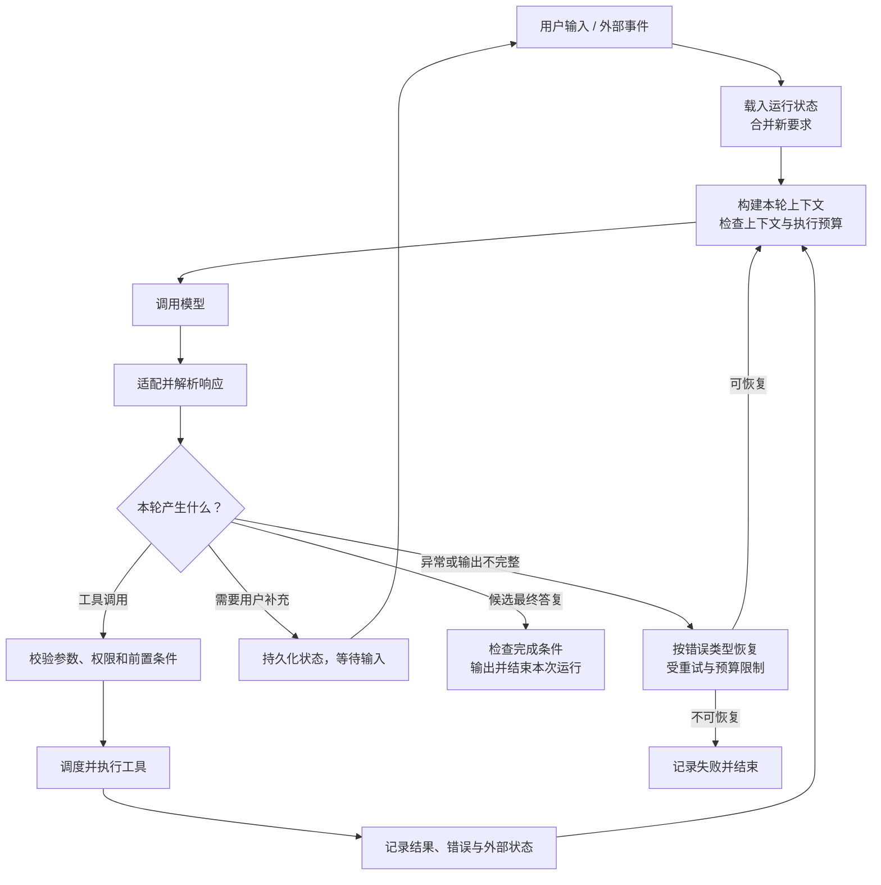
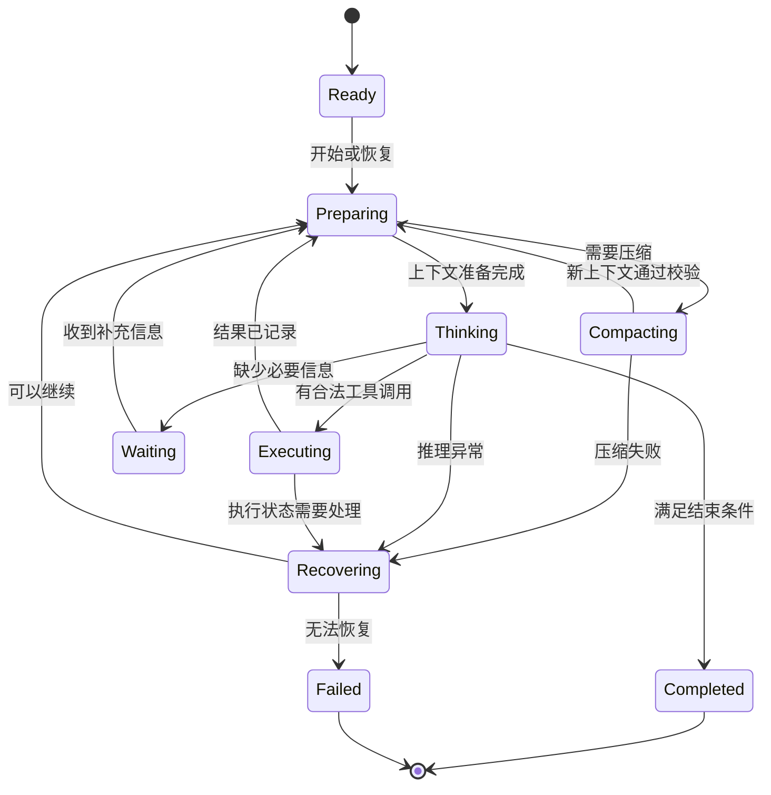
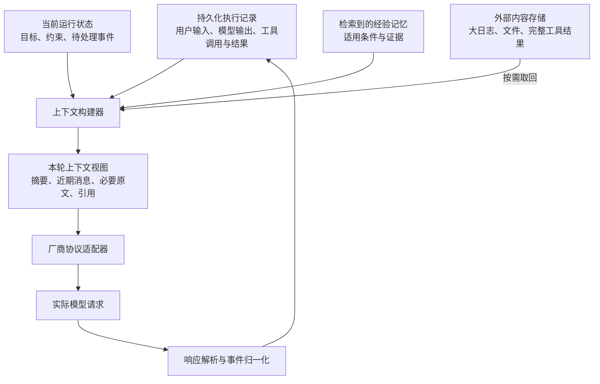

# 从一次请求讲清楚 Agent：主循环、工具、上下文与 Harness

本文面向准备自行开发或重构 Agent 框架的开发者，沿着一次任务的执行顺序，解释主循环、工具系统、状态管理、上下文、缓存、压缩、记忆和恢复如何配合。

本文综合文末列出的原作者资料，并给出工程设计建议。图中的状态、组件和接口属于设计示意，不是某个框架必须采用的标准，也不表示本项目已经实现。当前项目的实现链路见 [运行内核与调用链路](../internals.md)。

## 1. 模型、Agent loop 与 harness 的职责

调用模型、提供几个工具，很快就能做出能工作的原型。真正影响稳定性的，是随后出现的问题：

- 模型调用工具以后，谁负责继续？
- 用户中途改要求怎么办？
- 执行到一半退出，下次从哪里恢复？
- 上下文满了，哪些信息可以删？
- 工具执行超时，是没执行，还是执行成功但结果没传回来？

这些问题共同构成了 harness 的主要工作。

| 层次 | 主要职责 |
| --- | --- |
| 模型 | 根据本次输入，生成文字、工具调用等输出。 |
| Agent loop | 接收模型输出，执行动作，把观察结果送回模型，决定是否继续。 |
| Harness | 为循环提供上下文、工具、状态、权限、预算、存储、恢复和观测能力。 |

在常见的无状态推理 API 中，模型看到的是这次请求提供的内容。宿主程序负责维护历史、构建下一次请求。Amp 的 [How to Build an Agent](https://ampcode.com/notes/how-to-build-an-agent) 把这个过程直接展开成了代码。

这里讨论的 harness 主要指运行时执行系统。“Agent harness”与“评测 harness”需要区分：后者负责运行测试任务、记录轨迹、判定结果和汇总指标。

### 一次任务的完整执行链路



真正驱动循环的是宿主程序。图中的响应分类是宿主对完整响应作出的调度判断；一次流式响应可能同时包含文本和工具调用，不能看到文本就提前判定结束。

工具调用是常见的继续条件，但不是唯一条件。等待的任务完成、用户追加要求、响应被截断后恢复、上下文压缩完成，都可能促使系统重新调用模型。每一种继续，都应该有明确原因和预算。

模型返回的结束原因也要区分：正常结束、请求执行工具、输出长度用尽、连接异常，并不意味着同一种运行结果。空响应尤其需要处理，不能让任务无声结束，也不能无限重试。

## 2. 单循环还是双循环，要看控制权

程序里出现两层 `while`，不能直接说明它采用了“双 Agent 架构”。实际工程中，常见的是两个不同层次：

- **运行生命周期**：接收输入、启动任务、等待、取消、恢复。
- **模型与动作循环**：构建上下文 → 调用模型 → 执行动作 → 回传结果。

它们可以嵌套，也可以由同一个事件驱动器实现。

另一种“双循环”是规划者持续制定计划、执行者持续执行，再由评估者决定是否重做。这是另一种控制架构，需要额外的消息、状态同步和停止条件。

对于自行重构框架，建议先把一个主 Agent 的执行闭环做好，再根据失败案例决定是否加入独立规划或评估循环。

Anthropic 的 [Building Effective Agents](https://www.anthropic.com/engineering/building-effective-agents) 区分了 workflow 和 Agent：前者由预定义代码路径组织步骤，后者让模型动态决定过程与工具使用。两者可以组合。

例如，“寻找配置问题”可以交给模型探索；“参数必须通过校验才能写文件”适合由程序强制执行。

### 每轮执行需要维护的不变量

下面是设计建议，不是绑定某种语言的完整实现：

1. 在发出新请求前，处理已到达的用户补充和取消事件。
2. 从已提交的运行状态构建上下文，避免把尚未完成的动作当作事实。
3. 按协议完整解析工具调用，再开始执行。
4. 工具调用与结果保留关联标识。
5. 结果及恢复所需状态完成记录后，再推进后续步骤。
6. 每次继续都检查预算、取消和停止条件。

这些不变量比代码里有几层循环更能说明系统是否可靠。

## 3. 状态机管理运行事实，模型决定下一步尝试什么

状态机最有价值的用途，是让程序准确知道现在发生了什么，以及哪些转换合法。

一种可选设计如下：



取消、中断和预算耗尽也需要覆盖相关活动状态。图中为了保持可读性，省略了这些连线。

这里要区分两类状态：

| 状态 | 示例 | 用途 |
| --- | --- | --- |
| 运行状态 | 正在推理、等待工具、等待用户、已取消。 | 控制程序生命周期。 |
| 任务状态 | 已定位脚本、已读配置、修改尚未验证。 | 帮助任务推进和恢复。 |

不要把所有任务步骤都硬编码进运行状态机。否则，每增加一种任务，都要修改底层引擎。

但下面这些约束值得放进代码：

- 已取消的运行不能继续发起新的动作。
- 工具结果必须关联到对应调用。
- 旧请求晚到的结果不能覆盖新一轮状态。
- 不完整的流式参数不能直接执行。
- 重试、执行时间和上下文都有上限。

“控制流、状态和上下文由应用自己掌握”，也是 [12-Factor Agents](https://github.com/humanlayer/12-factor-agents) 中值得借鉴的部分。

### 等待与完成需要有不同语义

等待用户补充意味着当前运行仍有待处理事项；完成意味着本次运行已经结束。两者的恢复入口、界面状态和后续事件处理通常不同。

同样，工具进程退出、模型生成“已完成”和用户目标满足，也需要分别记录。可核验的完成条件应当来自任务所需的结果，例如文件确实写入、宿主实际接收任务、运行状态达到预期。

## 4. 工具系统分别处理可见性、权限和调度

“根据状态动态调整 tools”有价值，但需要拆成几个独立问题。

| 问题 | 由谁处理 |
| --- | --- |
| 系统有哪些工具？ | 工具注册表。 |
| 本轮模型需要知道哪些工具？ | 工具暴露策略。 |
| 当前状态允许执行哪些动作？ | 执行策略与权限校验。 |
| 多个调用能否同时运行？ | 调度器。 |

模型看见工具，不代表执行器必须接受调用；模型没看见工具，也不能代替权限控制。

例如，当前阶段只允许读取配置。即使模型请求写入，执行器也应检查并拒绝，而不是只依赖提示词里的“暂时不要修改”。

### 动态工具有多种实现

| 方式 | 好处 | 代价 |
| --- | --- | --- |
| 固定提供较小的一组工具。 | 简单，工具语义稳定。 | 能力增长后可能变得拥挤。 |
| 按领域或状态切换工具集。 | 减少无关工具。 | 要处理历史一致性及缓存影响。 |
| 提供检索入口，按需加载工具说明。 | 适合大量扩展工具。 | 增加发现步骤，可能漏选工具。 |

Manus 分享过一种方案：保持工具定义稳定，通过状态机约束动作选择，减少频繁增删定义对缓存和历史理解的影响。它使用的部分生成约束能力，需要模型服务支持。见 [Mask, Don't Remove](https://manus.im/blog/Context-Engineering-for-AI-Agents-Lessons-from-Building-Manus)。

生成阶段约束动作，与执行阶段拒绝非法调用，是两件需要分别设计的事。使用普通 API 时，不能假定宿主能够访问模型的 logits 或任意控制响应预填充。

所以，工具固定还是动态，需要分别测量：选错工具的频率、工具说明占用、缓存命中、额外发现轮次，以及任务成功率。

### 顺序来自依赖和冲突

```text
读取脚本说明 ─────┐
                 ├─ 可以并行
读取当前配置 ─────┘

生成新配置 → 写入配置 → 执行验证
             存在依赖，应按顺序

修改同一个文件 + 同时启动依赖该文件的任务
             存在冲突，需要协调
```

工具按什么顺序出现在定义列表中，不等于它们必须按这个顺序执行。一次响应提出多个调用，也不自动证明这些调用独立。

可以按资源、读写属性、依赖关系和宿主能力判断能否并行。对共享界面、同一配置文件、同一个宿主任务队列，尤其要防止相互影响。

### 工具契约影响模型行为

工具不仅需要可执行，还需要让模型知道：适用场景、必要参数、返回信息、失败含义，以及会不会产生副作用。

返回内容也不宜只剩一句“失败”。例如，可以区分参数不合法、资源不存在、宿主忙碌、连接中断和执行状态未知，并附上足够的修正线索。

Anthropic 的 [Writing Effective Tools for Agents](https://www.anthropic.com/engineering/writing-tools-for-agents) 讨论了工具粒度、命名、返回内容和真实任务评测。

## 5. 上下文是运行记录的一个视图

一个关键的设计建议：持久化的执行记录和发给模型的消息列表，应该允许分别管理。

如果两者完全混在一起，压缩就可能变成删除唯一证据；为了满足某家厂商的请求格式，也可能把内部状态结构改得越来越奇怪。

建议按下面的职责组织：



这样做以后：

- 完整工具结果可以保存在外部，只向模型提供必要片段。
- 历史仍然可追查，压缩后的上下文可以重新生成。
- 厂商差异留在适配层。
- 界面展示可以从运行事件中产生，不必反过来决定请求结构。

### 提示词和请求体的边界

构建提示词时，可以分清三个来源：

1. 稳定的行为规则与工具约定。
2. 当前任务目标、用户约束和补充要求。
3. 工具返回、网页、文件等外部材料。

外部材料需要保留来源和边界。工具错误也应作为工具结果或内部运行事件记录，避免伪装成用户发言。

厂商适配器负责角色、内容块、工具调用、结果关联、流式事件和结束原因等协议差异。厂商要求保留的不透明内容，应按其契约保存和回传，不能假定它们都能跨模型或跨协议复用。

不要只靠 JSON 看起来像聊天记录，就认为请求构建正确。还要核对它是否符合当前接口的消息顺序、内容类型、参数及历史回传要求。

Anthropic 的 [Effective Context Engineering for AI Agents](https://www.anthropic.com/engineering/effective-context-engineering-for-ai-agents) 将关注点放在“每次推理应该提供哪些信息”，并讨论了按需检索、压缩和外部笔记。

## 6. 缓存命中、自动压缩和长期记忆

这三件事容易混在一起，但它们解决的问题不同。

| 机制 | 保存或复用什么 | 解决的问题 |
| --- | --- | --- |
| 推理前缀缓存 | 已计算过的兼容输入前缀所对应的中间计算。 | 减少重复计算、延迟和费用。 |
| 上下文压缩 | 当前任务历史的精简表示。 | 让任务继续放进有限窗口。 |
| 长期记忆 | 跨任务可复用的知识和经验。 | 减少重复探路。 |

### 缓存不会补充未提供的信息

以概念上的前缀缓存为例：

```text
第一次：规则 + 工具定义 + 用户任务
第二次：规则 + 工具定义 + 用户任务 + 调用与结果
        └──── 可复用的相同前缀 ────┘
```

缓存能否复用，还取决于服务商的支持、有效期、路由和具体请求结构。应用能做的是尽量稳定前缀及序列化方式，并根据返回的 usage 数据验证，而不是只看两份 JSON 是否相似。

缓存命中也不保证请求完全不计费，或模型服务不再需要请求内容。具体行为与费用应以提供方的协议为准。相关工程经验见 [Manus 的上下文工程文章](https://manus.im/blog/Context-Engineering-for-AI-Agents-Lessons-from-Building-Manus)。

### 压缩需要主动设计

建议保留：

- 当前目标和用户明确约束。
- 已确认事实与仍然不确定的判断。
- 关键决策及其依据。
- 对后续有价值的失败尝试。
- 未完成动作，以及必要的文件、日志和结果引用。

触发条件还需要预留空间：

```text
预计输入量 + 预留输出量 + 必要的安全余量
应当小于模型的上下文上限
```

输入估算应包含工具定义等请求开销，并考虑当前接口的具体预算规则。不要等窗口彻底塞满，才拿同样超限的历史去请求摘要。

压缩完成后，还要检查当前协议要求的消息结构、工具调用关联和任务约束是否完整。压缩失败时，应保留原始记录，再尝试更小的输入或其他恢复方式。

摘要是对历史的一种有损表示。重要原文或完整结果可以留在可检索存储中，通过引用恢复；引用目标的保留期限与可访问性也需要管理。

Anthropic 的 [Effective Harnesses for Long-Running Agents](https://www.anthropic.com/engineering/effective-harnesses-for-long-running-agents) 指出，单靠 compaction 并不足以保证跨窗口持续完成任务，还需要可接续的状态、环境和验证机制。

### 经验记忆保存带条件的实现链路

避免重复探路，需要的是可复用操作经验。下面是一种记录示例：

```text
场景：给某类脚本补充运行配置。

已验证链路：
先读取脚本元数据，确认参数类型；
再检查当前配置，合并缺失字段；
最后用宿主提供的验证入口检查。

适用条件：
宿主版本和元数据格式仍然匹配。

已知失败：
只修改界面显示值，未必会保存到实际运行配置。

证据：
对应版本、接口来源、成功验证记录。

复用前：
先确认当前宿主仍提供这些能力。
```

这类记忆能减少重新探路，又给重新判断留下空间。具体路径和旧命令可以保留为线索，执行时仍需验证适用条件。

记忆的写入和检索也需要质量控制：区分成功验证与推测，合并重复经验，处理相互矛盾的记录，并让过时经验能够被修订或淘汰。检索到一条经验，不应直接扩大本次任务的执行权限。

## 7. Harness 的难点往往出现在失败以后

假设工具请求“启动任务”，随后连接超时，可能有两种情况：

1. 请求根本没到宿主。
2. 宿主已经启动任务，只是响应丢了。

如果一律重试，第二种情况可能重复启动。

因此，恢复策略需要区分：

| 情况 | 建议处理 |
| --- | --- |
| 明确的参数错误。 | 返回可理解的错误，让模型修正。 |
| 可安全重试的临时读取失败。 | 有限重试与退避。 |
| 有副作用且执行结果不明。 | 先查询实际状态，再决定是否重做。 |
| 权限或前置条件不满足。 | 等待满足条件，或结束该动作。 |
| 输出截断、解析失败。 | 按协议恢复，限制重复次数。 |
| 用户中断。 | 停止新动作，处理仍在运行的精确任务。 |

有副作用的动作，最好具备操作标识、可查询状态，或由宿主支持幂等执行。单靠本地日志，通常无法消除“外部已经执行、但本地还没记录”的窗口。

### 运行恢复不等于重新发送最后一个请求

恢复时，应检查哪些动作已经确认完成、哪些尚未执行、哪些状态不明，再决定继续路径。需要恢复的状态应保存在适当的检查点或执行记录中。

用户中途发来的要求，也应成为运行中的正式事件，在适当边界更新目标和约束。旧请求稍后返回，不能把新的要求覆盖掉。

这里可以考虑运行版本号、事件序号或请求代次，防止过期结果写回。取消模型请求也不自动证明外部工具已经停止，仍要核对关联任务的状态。

## 8. 重构前，让每一轮都能被解释和比较

如果 Agent 跑了三十轮，却无法回答下面这些问题，优化就容易变成猜测：

- 每轮为什么继续？
- 发给模型的上下文包含了什么？
- 当时有哪些工具可选，为什么调用被接受或拒绝？
- 时间花在模型、工具还是等待上？
- 压缩前后丢掉了哪些信息？
- 最后是真的完成，还是只生成了“已完成”的文字？

运行记录可以关联运行、模型请求、工具调用和事件序号，记录耗时、结束原因、预算消耗和恢复动作。记录范围与保留策略应考虑凭据和用户数据，不能为了排查问题默认永久保存全部敏感内容。

### 先固定一组任务

| 场景 | 主要验证什么 |
| --- | --- |
| 首次配置脚本。 | 能否找到正确实现链路。 |
| 相似任务再次出现。 | 经验记忆是否减少重复探路。 |
| 用户中途纠正要求。 | 新要求能否及时生效。 |
| 上下文接近上限。 | 压缩后是否保留关键约束。 |
| 工具超时但可能已执行。 | 是否避免重复副作用。 |
| 重启后恢复。 | 能否识别已完成和待确认动作。 |
| 多个工具存在依赖或冲突。 | 调度是否正确。 |

评测应同时看环境最终结果和执行过程。模型说“配置成功”，需要有对应的配置或宿主状态作为依据。Anthropic 的 [Demystifying Evals for AI Agents](https://www.anthropic.com/engineering/demystifying-evals-for-ai-agents) 对此作了明确区分。

比较框架改动时，尽量固定任务、模型、配置和环境；考虑模型输出的随机性，对重要场景做多次尝试。工具调用更少或缓存命中更高，不自动等于任务完成得更好。

### 一种建议的重构顺序

1. 固定失败案例与运行记录。
2. 明确状态、事件和各类停止条件。
3. 拆开持久化记录、上下文构建与厂商协议。
4. 整理工具暴露、执行策略和调度。
5. 完善压缩、恢复和经验记忆。
6. 用评测结果决定是否增加独立规划、评估或多 Agent 架构。

每完成一层，都用同一组任务比较成功率、耗时、调用成本和恢复表现，以此判断增加的复杂度是否值得。

## 原始资料与源码阅读

| 资料 | 作者或团队 | 建议阅读重点 |
| --- | --- | --- |
| [How to Build an Agent](https://ampcode.com/notes/how-to-build-an-agent) | Thorsten Ball / Amp，2025 年 4 月。 | 从零实现消息循环、工具分发与结果回填。 |
| [Building Effective Agents](https://www.anthropic.com/engineering/building-effective-agents) | Anthropic，2024 年 12 月。 | Workflow 与 Agent 的控制边界、常见组合模式。 |
| [12-Factor Agents](https://github.com/humanlayer/12-factor-agents) | Dex Horthy / HumanLayer。 | 上下文、状态、启动暂停恢复、控制流与 reducer。 |
| [Context Engineering for AI Agents: Lessons from Building Manus](https://manus.im/blog/Context-Engineering-for-AI-Agents-Lessons-from-Building-Manus) | Yichao Ji / Manus，2025 年 7 月。 | 缓存前缀、工具状态机、外部存储与失败经验。 |
| [Effective Context Engineering for AI Agents](https://www.anthropic.com/engineering/effective-context-engineering-for-ai-agents) | Anthropic，2025 年 9 月。 | 按需检索、压缩和外部笔记。 |
| [Writing Effective Tools for Agents](https://www.anthropic.com/engineering/writing-tools-for-agents) | Anthropic，2025 年 9 月。 | 工具粒度、描述、返回内容与评测。 |
| [Effective Harnesses for Long-Running Agents](https://www.anthropic.com/engineering/effective-harnesses-for-long-running-agents) | Anthropic，2025 年 11 月。 | 跨上下文窗口的增量执行与接续机制。 |
| [Demystifying Evals for AI Agents](https://www.anthropic.com/engineering/demystifying-evals-for-ai-agents) | Anthropic，2026 年 1 月。 | 任务、执行轨迹、环境结果和判定机制。 |
| [mini-swe-agent](https://github.com/SWE-agent/mini-swe-agent) | SWE-agent 团队。 | 对照阅读精简实现中的模型调用、动作执行与环境反馈。 |

建议先读 Amp、12-Factor Agents 和 Manus，再按需要深入工具设计、长任务与评测。文章中的厂商能力和产品示例有各自的时间背景，接入时应重新核对当前接口契约。
