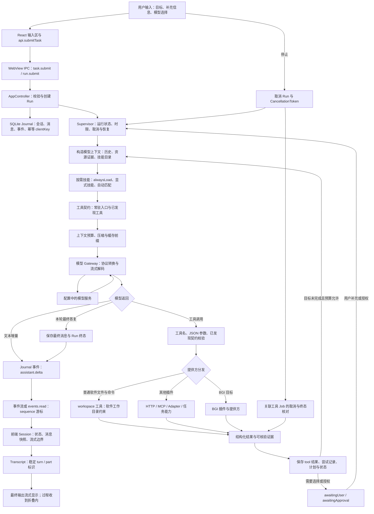
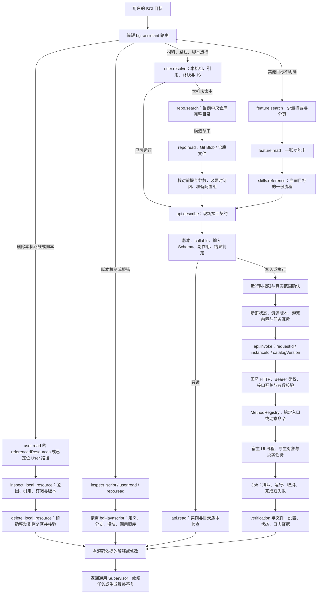
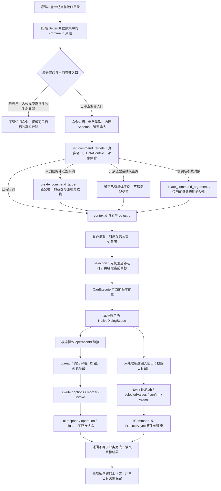
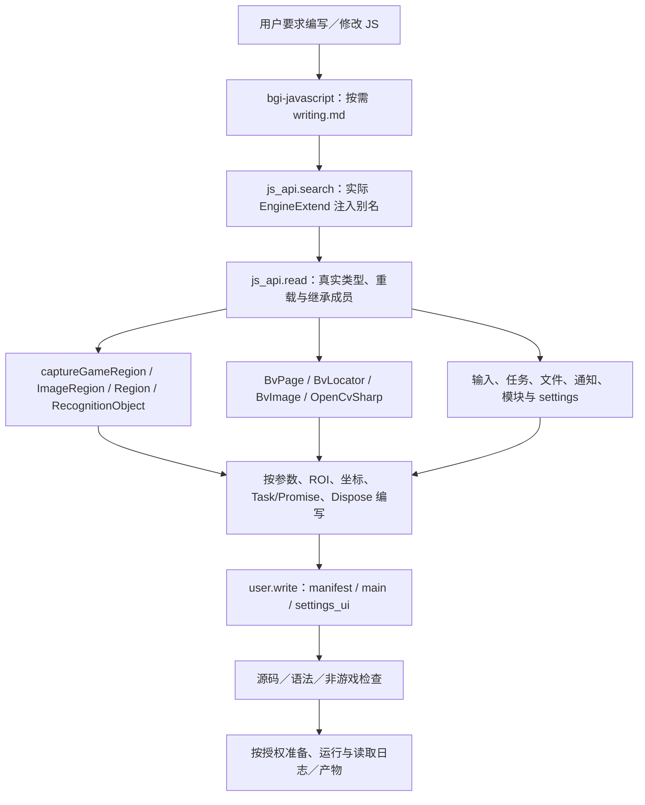
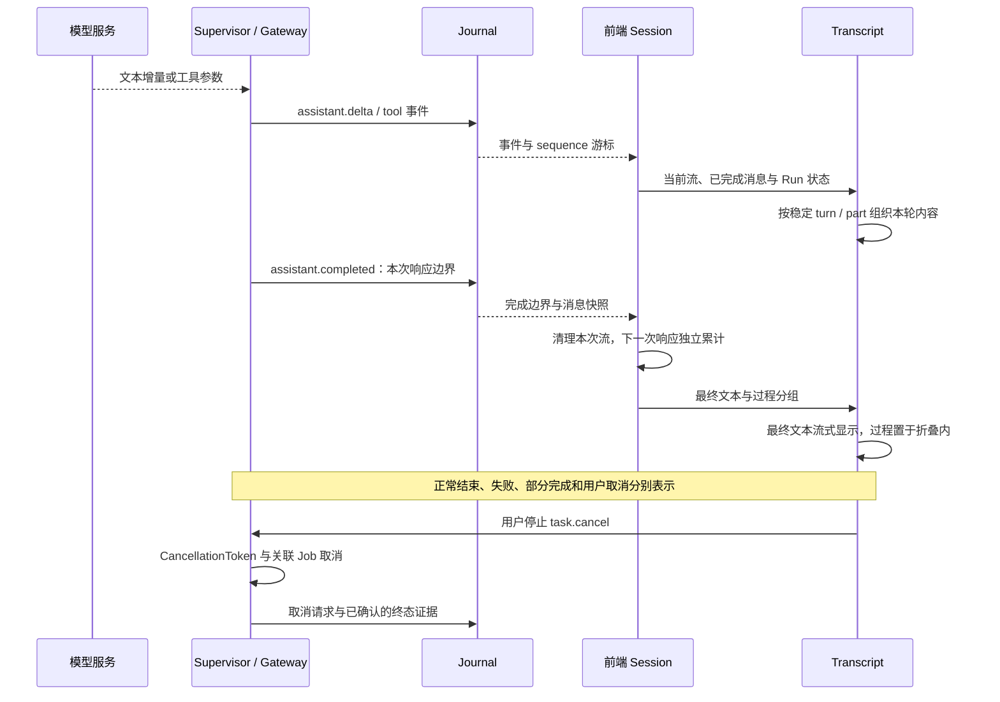
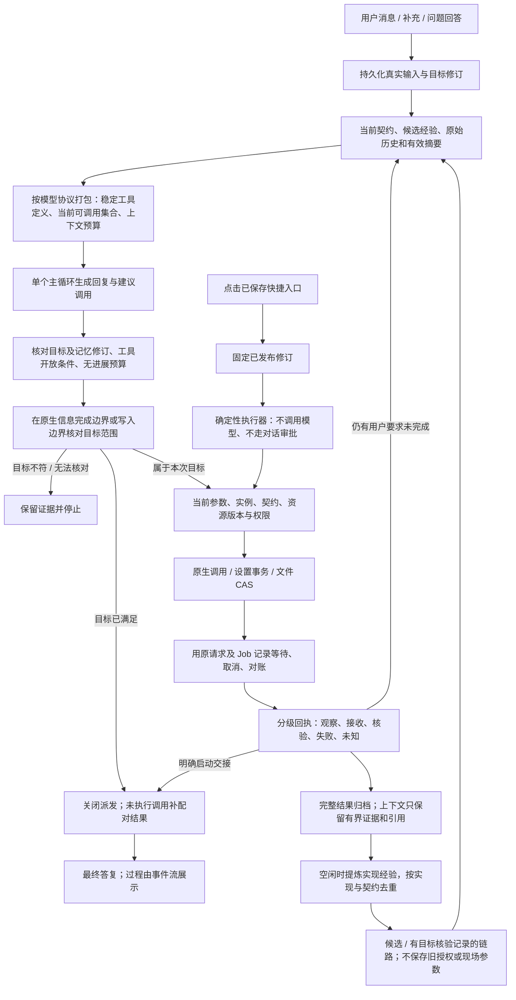

# 运行内核与调用链路

本文按当前代码路径描述；产品是通用游戏脚本工具 Agent，BGI 是其中一个提供方。图中的分支不要求每个请求全部经过。普通聊天可以直接回答，资源运行也不需要先加载整份功能目录。

## 总链路

实际源码入口：[前端 IPC](../web/src/ipc/api.ts)、[桌面 IPC 接收](../src/main.rs)、[AppController](../src/app/mod.rs)、[Supervisor](../src/runtime/mod.rs)、[模型 Gateway](../src/runtime/gateway.rs)、[Journal](../src/runtime/store/journal.rs)、[前端 Session](../web/src/session/index.ts)、[Transcript](../web/src/components/chat/Transcript.tsx)。

## BGI 子链路与渐进式披露

`feature-index.json` 是离线知识索引，不等于当前宿主目录，也不授予执行权限。模型不会常驻读取全部条目。明确的运行请求直接查资源，明确的 JS 问题直接读脚本；分类没有结果不能推导为全仓没有，查询失败也不能推导为不存在。

对应实现：[BGI 提供方工具](../src/bridge/mod.rs)、[离线功能索引](../src/bridge/features.rs)、[资源定位](../src/bridge/resolve.rs)、[检索路由](../src/bridge/retrieval.rs)、[运行时桥调用](../src/runtime/host/bridge.rs)、[托管桥宿主](../bgi-bridge/managed/Hosting/BridgeHost.cs)。

## 反射、对象、选择与弹窗链路

窗口与未注册子对象不会因为没有 `IViewModel` 标记而从目录消失。查询目录不构造窗口；构造是独立写操作。复杂对象以真实引用绑定，不能从用户 JSON 随意重建宿主对象。弹窗输入缺项、旧引用、同名多实例、错误参数和禁用命令均返回明确错误，不能把通用调用入口当绕过方式。

反射只负责定位真实对象和调用已审查的业务入口，不创造宿主未实现的业务。旧补接实现及其 implementationInput 已删除；弃用、占位和脱离真实控件的生命周期命令不发布；当前可见编辑器与模态窗口通过原生 UI 续接，不能因为需要交互就删除功能。正常路线执行走资源定位、prepare_pathing_group 和 run_script_group；截图测试使用当前原生 start_capture_test。接口审阅报告由 `bgi-bridge/dev/interface-review.py` 生成到 `target/reports/bgi/`。

对应实现：[命令发现与执行](../bgi-bridge/managed/Catalog/CommandCatalog.cs)、[目标与原生对象绑定](../bgi-bridge/managed/Bgi/CommandTargets.cs)、[上下文接口](../bgi-bridge/managed/Tools/CommandTargetTools.cs)、[本次弹窗输入](../bgi-bridge/managed/Bgi/NativeDialogScope.cs)。

## JS 编写、OCR 与真实引擎契约

契约只描述真实注入、可达类型与返回对象，不创建脚本引擎、不执行 OCR 或键鼠动作。OpenCV 类型集合按具体类型分页读取，避免把全部程序集装进模型上下文。源码回退与真实类型检查明确区分。

## 输出、折叠与停止

前端渲染依据实际消息、工具关联、流式边界和 Run 状态，不能先把过程当最终答案渲染后再移动。`assistant.completed` 表示一次模型响应结束，后面仍可能继续工具流程；Job `completed` 也不自动表示用户的游戏目标完成。只有核验实际终态后才报告已完成或已停止。

## 本轮工具开放与上下文压缩

普通 Agent 的内置工具初始开放 20 项，启用 BGI 时的完整内置注册表为 42 项。定位和读取入口常驻；同一提供方取得有效读取结果后开放相应修改能力，提交动作成功后开放状态核验能力。空检索、失败结果和环境信息不作为目标读取证据。其余工具可通过 `tools.search` 按需发现；发现工具不扩大用户授权，只读模式仍禁止实际写入。模型请求与执行端共用本轮策略，已保存任务继续按原修订执行。

工具定义按稳定顺序提供。直连 OpenAI Responses 时，已加载定义按发现顺序保留，以 `allowed_tools` 调整本轮调用资格；其他协议与未经核验的兼容端点采用实际列表过滤。新增工具仍可能改变提示前缀，不把本地前缀判定当成服务端缓存命中；实际缓存读取量单独记录。

文件读取默认返回 16,384 字符，批量读取默认总预算 32,768 字符，显式请求仍可扩大范围。大工具结果保存为产物引用，同时保留状态、路径、版本等简短证据；`artifact.read` 支持字符偏移分页，避免反复读取同一开头。

上下文预算按模型窗口预留输出和缓冲，小窗口使用相应缩小的默认输出预留。历史过长时按完整工具轮次规划压缩边界，再把原始记录作为资料分段交给摘要模型，逐段更新滚动摘要；不丢弃超长的第一组，也不拆成未配对的协议工具调用。所有片段成功后才提交摘要边界，原始消息保留，最新用户指令继续以原始角色和原文提供。服务端报超窗时主动压缩并缩小预算；空摘要、工具调用和截断摘要不会覆盖已有历史。

源码：[本轮工具策略](../src/runtime/tool_policy.rs)、[上下文规划](../src/runtime/context.rs)、[压缩执行](../src/runtime/mod.rs)。

## 跨会话操作经验

记忆默认启用，由 `runtime.memoryEnabled` 和界面开关共同控制，和会话一起保存在 `user/data/sleepy-doll.db`。它保存适用条件、经过观测的工具与原生入口顺序、参数来源、核验方法、失败分支和定位线索；不保存任务进度清单，也不直接回放上次的参数对象。

仅在 `memory.learn` 的触发类型、增量理由与本轮证据通过校验后，任务结束时才保存候选链路并入队提炼；普通成功轨迹不自动保存。空闲至少 45 秒后调度当前模型提炼关系，两次提炼请求的启动间隔至少 10 分钟；学习队列持久化，前台工作优先。已经发出的学习请求读取到结束再释放模型闸门，避免截断上游用量事件。学习失败不改变原任务结果，重试有界，其用量记录在学习队列和 `memory.learned` 事件中。

新请求根据目标做中英文检索，只自动引用当前工具参数契约仍匹配、且没有已确认失效入口的经验。引用使用独立的 `context` 消息记录，发给模型时编码为协议支持的 user 数据；不是用户原话，不参与用户授权判断，不改变系统提示，也不解锁工具。原生入口不存在或当前契约标明不可调用时暂时排除，后续真实读取到可用契约才恢复。临时连接失败不造成永久失效。

经验只提供候选方案，仍须读取本次条件、当前接口与现场对象；路径只是定位线索，旧版本值、目录版本、Job ID 和权限不继承。默认最多注入四条相关简介，总计不超过 2048 字符或更小的上下文份额，历史简介只保留最新一份；`memory.search` 返回简介，`memory.read` 按需取得详情。记忆超出本轮预算时不挤掉当前请求。左侧“记忆”页可查看、搜索、编辑和删除；设置只保留开关与管理按钮；删改采用版本校验，后台旧结果不能覆盖新修订；AI 通过 `memory.read` 读取当前条目后，可用 `memory.revise` 引用本轮事实合并修订，包括人工编辑的条目。最多暂存三条，本轮结束时统一提交；中止、关闭开关或版本冲突会丢弃草稿，已删改经验不再通过历史引用提供给模型。自动提炼只接受成功轨迹中出现的工具和原生入口，并省略凭据。

源码：[经验存储与提炼](../src/runtime/memory.rs)、[运行时接入](../src/runtime/mod.rs)、[经验管理界面](../web/src/pages/memory/MemoryPage.tsx)。

## 所有权与边界

| 层 | 负责什么 |
|---|---|
| 通用 Agent | 会话、上下文、模型协议、技能与工具发现、权限、计划、预算、取消、结果输出 |
| BGI 插件／提供方 | BGI 目标路由、资源与仓库语义、功能索引、脚本理解、领域前置和核验规则 |
| Rust BGI 客户端 | 契约发现、实例与目录版本、资源校验、审批、状态新鲜度、请求幂等、Job 跟踪 |
| 托管桥 | 回环鉴权、Schema、UI 线程、反射、原生对象／选择／弹窗绑定、宿主执行与结果 |
| BGI 本体 | 游戏识别与任务算法、宿主资源、原生配置 setter、实际窗口、脚本环境、取消上下文 |
| React 界面 | 输入、任务状态、事件合并、流式文本、过程折叠与最终答复展示 |

调用链和源代码检查能核验工程连接，隔离宿主能核验参数／对象／弹窗适配；真实游戏识别、角色前提、实际收益与跨会话环境仍要现场验证。测试结果与当前已运行的桥版本分开记录，不能用新 DLL 已编译代替新版本已注入。
## 目标、证据与运行治理

真实输入在本机接纳事务里登记来源及目标修订。模型协议里的 `user` 角色、工具输出、技能、经验和压缩摘要不具备这种来源，不能改变目标。决策绑定目标修订与记忆修订，派发前及写入等待结束后复核；来源变化时保留工具配对，重新处理最新输入。

BGI 的资源优先检索、配置组批量合并和启动交接位于适配层。`bgi.feature.read(live:true)` 每次最多读取四个当前契约，按条目区分可执行、仅参考、不可用和未知；静态功能卡或 JS 成员说明不代表可以直接执行。中央 Git 文件读取不依赖订阅，脚本解释与现成路线运行使用不同入口。

范围核对是选择性语义判断，不是自由文本意图的数学证明。确定性保证来自来源、修订、参数及版本检查、原请求幂等、回执和终结闸门；不能用另一次模型回答代替原生核验。任意 shell／JS 的全部副作用也不能从声明推导出来。启动核验只证明交接，取消只证明取消请求或可观测终态，不表示撤销已发生的效果。

记忆默认启用，可由用户关闭使用和学习。自动轨迹先作为候选；只有相关目标与目标证据同时成立才标记已有核验记录。删除使用实现墓碑，编辑使用修订比较；引用旧记忆的压缩摘要失效后，重新投影仍保留的原始历史。后台提炼不占前台模型锁，已发送请求即使丢弃结果也记账；未收到用量时保留明确估算，不自动重发未知计费的提炼请求。

`app.identity` 提供编译时版本、Git 修订、脏工作区标志和数据格式版本。`run.usage` 按 foreground、scope、compaction、memory 返回请求数、报告／估算用量和服务端缓存读取量；它不是账单金额。旧程序不可直接降级打开新格式数据库，分发必须同时核对应用、桥和数据迁移。

回归入口：`cargo test --no-default-features --lib` 覆盖真实输入来源、同批额外调用、条件继续、过期决策、原请求恢复、字段回退、记忆去重／删除、摘要失效和后台记账；`tests/runtime/shortcut-permissions-check.py` 通过真实控制器验证四种权限下的固定入口。以上夹具不代替真实模型和游戏内逐项验收。

记忆写入默认不触发。系统提示词只允许四种情况：用户明确要求记住可复用做法、直接证据推翻旧记忆、非显然故障已查因并验证修复、发现会改变后续做法的稳定非显然约束；同时必须已核实、可跨任务复用、存在实质增量且事实已收齐。常规成功、任务结束、状态/参数变化、上下文压缩和冷却时间到期均不触发。新增须经 `memory.learn` 提供触发类型、理由和本轮证据，原有自动保存与提炼队列入口只接受已批准的申请；修订须经同样的触发校验。维护不发送中途回复或主动追加总结，界面将同轮记忆调用合并为一条简短记录。

### 系统提示词的分层与预算

常驻核心仅保留身份、事实与权限边界、文件并发修改纪律、记忆触发条件和回复方式，限制在 1200 字符内。文件分页、统计和参数说明由对应工具描述提供；快捷入口表单只增加本次封装边界，应用调用细节仍从技能获取。按需技能、记忆详情和用户自定义指令不算进核心预算，不通过截断这些内容缩短核心。

记忆的四种触发类型继续常驻；工具的 `trigger` 枚举必须在核心规则中有解释，运行时的证据、去重与静默展示校验不变。回归检查同时验证字符预算、通用核心不含 BGI 方法，以及真实模型请求使用当前核心并保留稳定的系统前缀。字符预算不等同于模型 token 数或整次请求长度。
