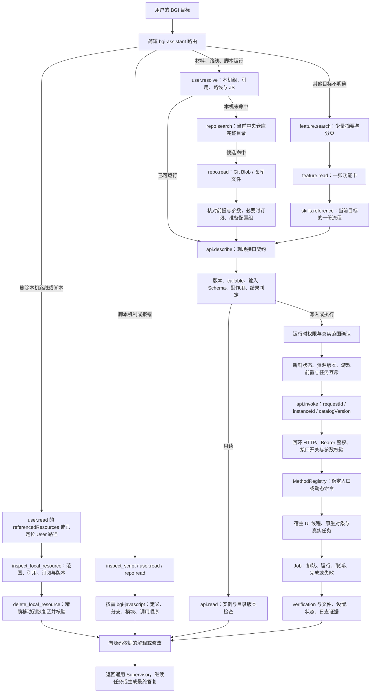
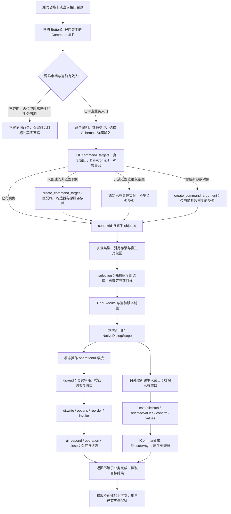
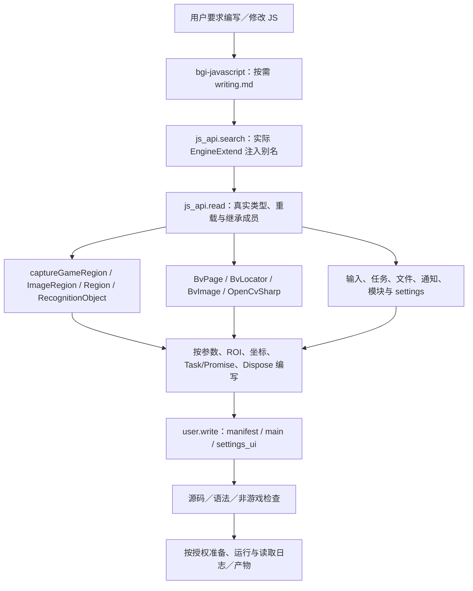
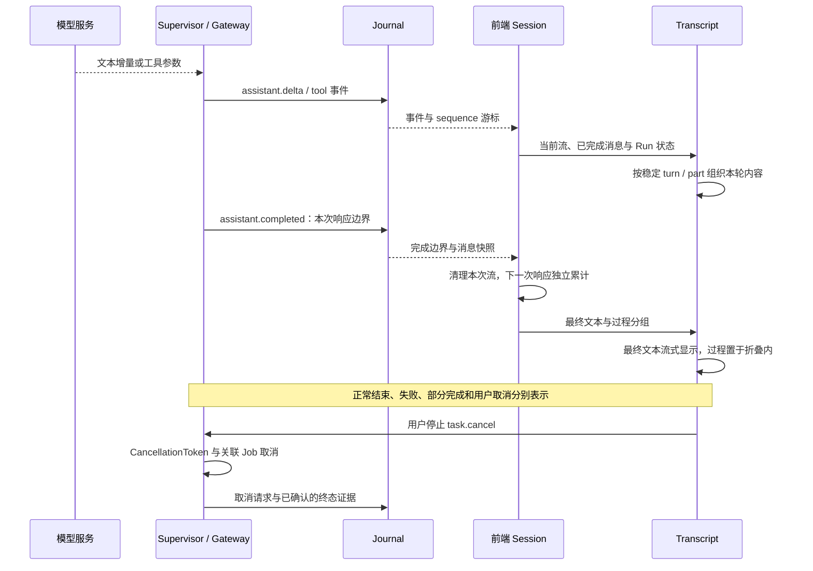
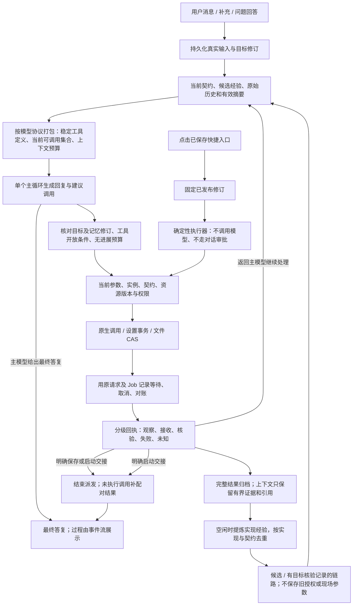
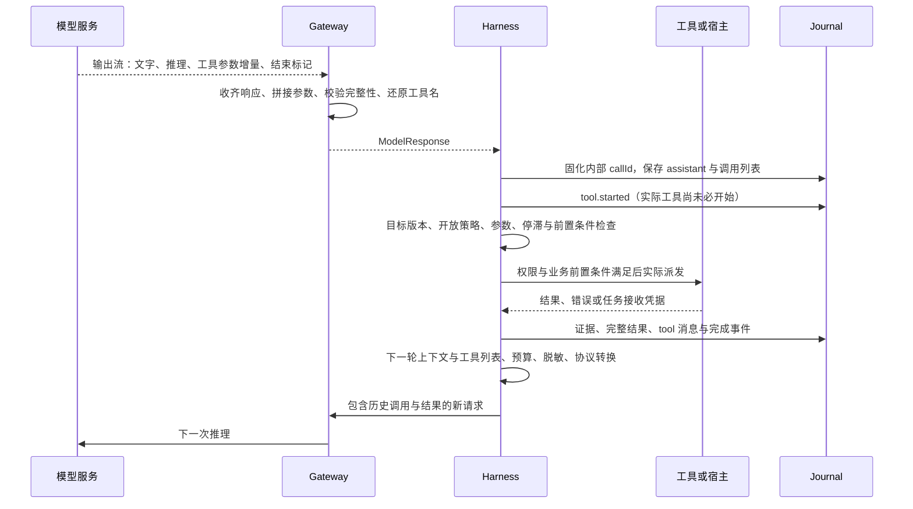

# 运行内核与调用链路

本文按当前代码路径描述；产品是通用游戏脚本工具 Agent，BGI 是其中一个提供方。图中的分支不要求每个请求全部经过。普通聊天可以直接回答，资源运行也不需要先加载整份功能目录。

## 总链路


实际源码入口：[前端 IPC](../web/src/ipc/api.ts)、[桌面 IPC 接收](../src/main.rs)、[AppController](../src/app/mod.rs)、[Supervisor](../src/runtime/mod.rs)、[模型 Gateway](../src/runtime/gateway.rs)、[Journal](../src/runtime/store/journal.rs)、[前端 Session](../web/src/session/index.ts)、[Transcript](../web/src/components/chat/Transcript.tsx)。

## BGI 子链路与渐进式披露



`feature-index.json` 是离线知识索引，不等于当前宿主目录，也不授予执行权限。模型不会常驻读取全部条目。明确的运行请求直接查资源，明确的 JS 问题直接读脚本；分类没有结果不能推导为全仓没有，查询失败也不能推导为不存在。

对应实现：[BGI 提供方工具](../src/bridge/mod.rs)、[离线功能索引](../src/bridge/features.rs)、[资源定位](../src/bridge/resolve.rs)、[检索路由](../src/bridge/retrieval.rs)、[运行时桥调用](../src/runtime/host/bridge.rs)、[托管桥宿主](../bgi-bridge/managed/Hosting/BridgeHost.cs)。

BGI 工具由插件清单引用标准 MCP 服务装载。工具发现、普通调用，以及运行内核的原生请求与 Job 事件，通过同一 MCP 连接进入 BGI 提供方；提供方内部继续使用宿主桥协议。通用 MCP 客户端同时支持 stdio 和 Streamable HTTP，协议由官方 `rmcp` SDK 实现。应用内服务通过字节管道执行真实协议往返；对外另有 stdio 入口，见 [插件格式](extensions.md#mcp)。

## 反射、对象、选择与弹窗链路



窗口与未注册子对象不会因为没有 `IViewModel` 标记而从目录消失。查询目录不构造窗口；构造是独立写操作。复杂对象以真实引用绑定，不能从用户 JSON 随意重建宿主对象。弹窗输入缺项、旧引用、同名多实例、错误参数和禁用命令均返回明确错误，不能把通用调用入口当绕过方式。

反射只负责定位真实对象和调用已审查的业务入口，不创造宿主未实现的业务。旧补接实现及其 implementationInput 已删除；弃用、占位和脱离真实控件的生命周期命令不发布；当前可见编辑器与模态窗口通过原生 UI 续接，不能因为需要交互就删除功能。正常路线执行走资源定位、prepare_pathing_group 和 run_script_group；截图测试使用当前原生 start_capture_test。接口审阅报告由 `bgi-bridge/dev/interface-review.py` 生成到 `target/reports/bgi/`。

对应实现：[命令发现与执行](../bgi-bridge/managed/Catalog/CommandCatalog.cs)、[目标与原生对象绑定](../bgi-bridge/managed/Bgi/CommandTargets.cs)、[上下文接口](../bgi-bridge/managed/Tools/CommandTargetTools.cs)、[本次弹窗输入](../bgi-bridge/managed/Bgi/NativeDialogScope.cs)。

## JS 编写、OCR 与真实引擎契约



契约只描述真实注入、可达类型与返回对象，不创建脚本引擎、不执行 OCR 或键鼠动作。OpenCV 类型集合按具体类型分页读取，避免把全部程序集装进模型上下文。源码回退与真实类型检查明确区分。

## 输出、折叠与停止



前端渲染依据实际消息、工具关联、流式边界和 Run 状态，不能先把过程当最终答案渲染后再移动。`assistant.completed` 表示一次模型响应结束，后面仍可能继续工具流程；Job `completed` 也不自动表示用户的游戏目标完成。只有核验实际终态后才报告已完成或已停止。

## 本轮工具开放与上下文压缩

普通 Agent 的初始工具集由当前注册表和本轮开放策略计算；历史观测读取入口可按需发现。定位和读取入口常驻；同一提供方取得有效读取结果后开放相应修改能力，提交动作成功后开放状态核验能力。空检索、失败结果和环境信息不作为目标读取证据。其余工具可通过 `tools.search` 按需发现；发现工具不扩大用户授权，只读模式仍禁止实际写入。模型请求与执行端共用本轮策略，已保存任务继续按原修订执行。

工具定义按稳定顺序提供。直连 OpenAI Responses 时，已加载定义按发现顺序保留，以 `allowed_tools` 调整本轮调用资格；其他协议与未经核验的兼容端点采用实际列表过滤。新增工具仍可能改变提示前缀，不把本地前缀判定当成服务端缓存命中；实际缓存读取量单独记录。

文件读取默认返回 16,384 字符，批量读取默认总预算 32,768 字符，显式请求仍可扩大范围。大工具结果保存为产物引用，同时保留状态、路径、版本等简短证据；`artifact.read` 支持字符偏移分页，避免反复读取同一开头。

上下文预算按模型窗口预留输出和缓冲，小窗口使用相应缩小的默认输出预留。历史过长时按完整工具轮次规划压缩边界，再把原始记录作为资料分段交给摘要模型，逐段更新滚动摘要；不丢弃超长的第一组，也不拆成未配对的协议工具调用。所有片段成功后才提交摘要边界，原始消息保留，最新用户指令继续以原始角色和原文提供。服务端报超窗时主动压缩并缩小预算；空摘要、工具调用和截断摘要不会覆盖已有历史。

源码：[本轮工具策略](../src/runtime/tool_policy.rs)、[上下文规划](../src/runtime/context.rs)、[压缩执行](../src/runtime/mod.rs)。

### 动态资料、历史观测与有界并行

system 保留稳定核心规则、工具开放约定、用户自定义指令及快捷入口的模式边界。技能目录、匹配技能正文与偏好通过有内容版本的 Context 消息追加；内容不变不重复追加，资料发生变化则新增版本。摘要覆盖这些消息后，会从当前配置重新生成必要资料。原始消息和厂商签名推理不被改写。

旧工具正文清理后保留 snapshot.callId、观测时间与可用的资源版本；`observation.read` 按字符分页读取当时落盘的完整结果，不重新执行工具。读取范围限定为当前会话和当前运行的历史边界；需要最新状态时才再次调用原工具。大结果仍可通过 `artifact.read` 读取。

独立、安全的只读调用使用四个执行位持续补位，每项完成即记录结果，下一轮模型请求仍等待合法的完整调用配对。提供方声明的顺序批次与写操作保持顺序执行。批次归一化、合并结果标记和交接文案由提供方返回，内核处理配对和终态。

源码：[动态资料](../src/runtime/working_context.rs)、[并行调度](../src/runtime/scheduling.rs)、[批次契约](../src/runtime/host/dispatch.rs)、[BGI 批次实现](../src/bridge/task_semantics.rs)。

### 可复用执行依据

执行依据只汇总真实用户输入修订、主模型计划、目标解释和实际资源版本，不批准动作，也不证明任务完成。plan.update 可记录主模型提供的 goalUnderstanding；其中 quote 必须逐字来自当前对话的真实人类输入，工具、摘要和记忆不能伪造来源。

任务解释、准备步骤、流程选择、失败纠正和跨轮续办由主模型读取技能处理。运行时不再发起独立的语义范围审查，也不把审查文本直接变成最终回答。相同调用连续返回相同结果时，只阻止再次重复并把错误返回主模型；新方法仍可继续，硬性时限和用户取消照常生效。

源码：[事实记录](../src/runtime/execution_basis.rs)、[机械重复限制](../src/runtime/scope.rs)。


## 跨会话操作经验

记忆默认启用，由 `runtime.memoryEnabled` 和界面开关共同控制，和会话一起保存在 `user/data/sleepy-doll.db`。它保存适用条件、经过观测的工具与原生入口顺序、参数来源、核验方法、失败分支和定位线索；不保存任务进度清单，也不直接回放上次的参数对象。

模型根据已核实的事实与后续复用价值自行决定是否调用 `memory.learn`，不受流程长度、工具种类数量或耗时门槛限制。程序校验本轮证据与去重，任务结束且前台空闲时即可提炼，无固定延迟或冷却；Rust 不拼接记忆正文。任务整体待核对时也能保存已确认的局部发现。学习队列持久化，前台工作优先；已经发出的学习请求读取到结束，避免截断上游用量事件。学习失败不改变原任务结果，其用量按真实响应记录。

新请求根据目标做中英文检索，只自动引用当前工具参数契约仍匹配、且没有已确认失效入口的经验。引用使用独立的 `context` 消息记录，发给模型时编码为协议支持的 user 数据；不是用户原话，不参与用户授权判断，不改变系统提示，也不解锁工具。原生入口不存在或当前契约标明不可调用时暂时排除，后续真实读取到可用契约才恢复。临时连接失败不造成永久失效。

自动召回随当前真实目标、定位证据、已发现能力和记忆版本变化刷新；显式技能选择也跟随用户补充更新。召回在截取前过滤不兼容契约，相关性相同时优先已有核验记录。经验只提供候选方案，仍须读取本次条件、当前接口与现场对象；路径只是定位线索，旧版本值、目录版本、Job ID 和权限不继承。默认最多注入四条相关简介，总计不超过 2048 字符或更小的上下文份额，历史简介只保留最新一份；`memory.search` 返回简介，`memory.read` 按需取得详情。记忆超出本轮预算时不挤掉当前请求。左侧“记忆”页可查看、搜索、编辑和删除；设置只保留开关与管理按钮；删改采用版本校验，后台旧结果不能覆盖新修订；AI 通过 `memory.read` 读取当前条目后，可用 `memory.revise` 引用本轮事实合并修订，包括人工编辑的条目。最多暂存三条，本轮结束时统一提交；中止、关闭开关或版本冲突会丢弃草稿，已删改经验不再通过历史引用提供给模型。自动提炼只接受成功轨迹中出现的工具和原生入口，并省略凭据。

源码：[经验存储与提炼](../src/runtime/memory.rs)、[运行时接入](../src/runtime/mod.rs)、[经验管理界面](../web/src/pages/memory/MemoryPage.tsx)。

## 所有权与边界

| 层 | 负责什么 |
|---|---|
| 通用 Agent | 会话、上下文、模型协议、技能与工具发现、权限、计划、预算、取消、结果输出 |
| BGI 插件／提供方 | BGI 目标路由、资源与仓库语义、功能索引、脚本理解、领域前置和核验规则 |
| Rust BGI 客户端 | 契约发现、实例与目录版本、资源校验、审批、状态新鲜度、请求幂等、Job 跟踪 |
| 托管桥 | 回环鉴权、Schema、UI 线程、反射、原生对象／选择／弹窗绑定、宿主执行与结果 |
| BGI 本体 | 游戏识别与任务算法、宿主资源、原生配置 setter、实际窗口、脚本环境、取消上下文 |
| React 界面 | 输入、任务状态、事件合并、流式文本、过程折叠与最终答复展示 |

调用链和源代码检查能核验工程连接，隔离宿主能核验参数／对象／弹窗适配；真实游戏识别、角色前提、实际收益与跨会话环境仍要现场验证。测试结果与当前已运行的桥版本分开记录，不能用新 DLL 已编译代替新版本已注入。
## 目标、证据与运行治理

真实输入在本机接纳事务里登记来源及目标修订。模型协议里的 `user` 角色、工具输出、技能、经验和压缩摘要不具备这种来源，不能改变目标。决策绑定目标修订与记忆修订，派发前及写入等待结束后复核；来源变化时保留工具配对，重新处理最新输入。



BGI 的资源优先检索、配置组批量合并和启动交接位于适配层。`bgi.feature.read(live:true)` 每次最多读取四个当前契约，按条目区分可执行、仅参考、不可用和未知；静态功能卡或 JS 成员说明不代表可以直接执行。中央 Git 文件读取不依赖订阅，脚本解释与现成路线运行使用不同入口。

主模型负责语义判断，Rust 负责真实输入来源、参数、权限、修订与资源版本、幂等、回执和执行状态。技能不产生权限；任意 shell／JS 的全部副作用不能从文字声明推导。启动回执只证明交接，取消请求不表示已撤销副作用。

真实用户以独立的 `$create-shortcut` 或封装表单开始一轮时，工具限制为只读、提问和保存入口。保存使用真实契约与参数校验；成功后按实际保存结果结束，同批后续调用补未执行记录，不运行被封装目标。历史或工具中出现该标记不解锁执行。任务和字段含义由 create-shortcut 及对应应用的技能解释。

记忆默认启用，可由用户关闭使用和学习。自动轨迹先作为候选；只有相关目标与目标证据同时成立才标记已有核验记录。删除使用实现墓碑，编辑使用修订比较；引用旧记忆的压缩摘要失效后，重新投影仍保留的原始历史。后台提炼不占前台模型锁，已发送请求即使丢弃结果也记账；未收到用量时保留明确估算，不自动重发未知计费的提炼请求。

`app.identity` 提供编译时版本、Git 修订、脏工作区标志和数据格式版本。`run.usage` 按 foreground、compaction、memory 返回（历史 scope 用量仍保留）请求数、报告／估算用量和服务端缓存读取量；它不是账单金额。旧程序不可直接降级打开新格式数据库，分发必须同时核对应用、桥和数据迁移。

回归入口：`cargo test --no-default-features --lib` 覆盖真实输入来源、同批额外调用、条件继续、过期决策、原请求恢复、字段回退、记忆去重／删除、摘要失效和后台记账；`tests/runtime/shortcut-permissions-check.py` 通过真实控制器验证四种权限下的固定入口。以上夹具不代替真实模型和游戏内逐项验收。

记忆由模型按事实和复用价值判断，简单任务中有效的入口、参数来源和可靠做法同样可以保存。新增用 `memory.learn` 提供理由与本轮证据；修订先读取当前条目，再用 `memory.revise` 合并事实。相关发现集中处理、重复内容合并，避免每轮机械保存和无差别灌入上下文。维护不发送中途回复或主动追加总结，界面将同轮记忆调用合并为一条简短记录。

### 系统提示词的分层与预算

常驻核心保留身份、目标理解与来源选择、事实与权限边界、文件并发修改纪律、模型自主判断记忆的原则和回复方式，限制在 1200 字符内。文件分页、统计和参数说明由对应工具描述提供；快捷入口表单只增加本次封装边界，应用调用细节仍从技能获取。按需技能、记忆详情和用户自定义指令不算进核心预算，不通过截断这些内容缩短核心。

来源选择跟随当前知识缺口：先明确对象、成功条件与依赖，区分领域事实、本机状态和软件契约，再选能回答问题的来源。必要外部事实不确定时可先联网补齐，不以穷尽本机目录为前提；已有可靠事实则直接继续。接口目录用于定位软件能力，不用于推导外部领域知识。该原则指导模型判断，不添加关键词触发器、固定渠道顺序或强制联网状态。

核心只保留由模型根据事实和复用价值自主判断的记忆原则；工具不要求固定 `trigger` 枚举，运行时保留证据、去重与静默展示校验。回归检查同时验证字符预算、通用核心不含 BGI 方法，以及真实模型请求使用当前核心并保留稳定的系统前缀。字符预算不等同于模型 token 数或整次请求长度。

### 内部上下文与失败边界

模型总容量保持用户配置，默认仍为 256k。内部辅助输出预算与总容量分开：压缩和记忆维护最多预留 8192 输出 token，且不超过用户输出限制；压缩还按本轮窗口分配。总输入和输出受模型容量及 runtime.maxTokens 中更小的值约束。压缩最多等待 180 秒，并受前台本轮剩余时间约束；记忆维护独立计时 120 秒，不继承已结束任务的截止时间。强制思考模型仍须给可见结果留足预算，不用未经支持的关闭思考参数规避限制。

| 已落实的约束 | 回归覆盖 |
| --- | --- |
| 同一 token 估算偏差只校准一次，不能每轮重复相乘缩小有效窗口 | `calibration_does_not_repeatedly_shrink_for_the_same_estimator_error` |
| 辅助压缩和记忆使用独立输出预算，不抬高模型总容量 | `calibration_does_not_repeatedly_shrink_for_the_same_estimator_error` |
| 备用模型容量不足时不派发超长请求，输出与窗口参数校验前置 | `fallback_with_smaller_window_is_not_sent_an_oversized_request` |
| 回复被截断时不执行其中的工具调用 | `truncated_tool_decisions_are_never_dispatched_or_retried` |
| 真实用户历史按需读取，任务由主模型理解，重复错误不自动结束任务 | `followup_skill_and_real_user_inputs_are_disclosed_only_when_requested`、`repeated_identical_calls_report_to_main_model_without_concluding_task` |
| 压缩后缺失的本轮真实输入按原始来源恢复，包含禁止项；不把摘要或工具文字升级为授权 | `compaction_cannot_remove_current_human_prohibitions_or_create_new_authority` |
| 技能正文未装入时明确列出未载入的名称，不能静默当成已读 | `omitted_instructions_are_named_without_partial_body_or_budget_overrun` |
| 工具发现按中英文关键词排序，只返回候选摘要；完整调用契约按需开放 | `mixed_keywords_and_chinese_sentences_find_real_contracts` |
| 已保存入口通过 shortcut.list/get 查询和分页，不扫描软件内部存储 | `stored_shortcuts_have_read_only_lookup_without_database_or_model_access` |
| 普通文件工具拒绝读取、覆盖或删除本软件凭据配置，递归搜索跳过该文件 | `own_credentials_config_is_not_a_business_file_or_search_result` |
| 发给模型的普通正文脱敏当前软件连接凭据；不修改原始历史和签名推理，无法安全回传的历史参数会阻止发送 | `model_context_redacts_legacy_credentials_without_rewriting_signed_reasoning` |
| 正常穿插其他观测后的再次读取不按连续停滞处理 | `necessary_rereads_after_other_observations_are_not_a_stagnant_loop` |

通用快捷任务技能仅规定读取、核对、封装、保存和终结；BGI 的具体接口、批量参数、运行前提与示例保留在插件的 `references/quick-tasks.md`。以上文件保护是普通工具的行为边界，不是操作系统沙箱；明确授权的 Shell 仍具有其运行权限。隔离回归不代替真实模型、当前安装包与游戏内执行的验收。


运行时优化回归见 [harness-optimization.rs](../tests/runtime/harness-optimization.rs)，通过生产 session、工具调用和持久化路径覆盖用户补充、稳定 system、原始观测隔离、并行补位、精确计划复用和失效条件；这些模拟模型回归不代表真实厂商的成功率或实际游戏性能。


### 辅助结果通过 tool use 返回

记忆提炼只提供一个专用结果工具，通过工具参数提交，不解析正文 JSON。它不进入业务执行器；结果必须唯一、完整并通过 schema，候选工具和方法来自真实成功观测。主循环不使用辅助模型审查业务意图。

辅助请求的输入预算包含工具定义和结果协议提示，成功、失败与丢弃结果继续记账。压缩摘要仍使用正文。工具选择的协议差异与大型插件设计见 [扩展格式：渐进式披露](extensions.md#大型插件的渐进式披露)，实现见 [structured.rs](../src/runtime/structured.rs)、[usage.rs](../src/runtime/usage.rs) 和 [gateway.rs](../src/runtime/gateway.rs)。


## 模型工具往返与缓存前缀

本节按 2026-10-22 当前工作区源码说明，包含尚未打包发布的 harness 改动；不是对已安装程序或线上耗时的验收结论。

### 从模型输出到下一轮输入



1. Gateway 在响应流结束后通过 Decoder.finish 收束工具参数；参数从 JSON 解码成 Value，检查结束标记、重复调用 ID、参数是否为对象和输出是否截断。当前没有在单个参数片段刚到达时就执行工具。工具名在网络侧使用稳定编码，返回时映射回内部名称。
2. session 应用单轮及总调用预算，把厂商调用 ID 替换为内部 UUID，并将 assistant 文本、调用列表和原始推理载荷保存到历史。ID 只在接收时生成一次；旧轮次不会在每次发请求时重生成。超额未执行调用也保留配对错误结果。
3. 顺序路径在调用 tool() 前发送 tool.started。随后仍需检查目标修订、工具开放、参数、Hook、权限和资源版本，因此事件不等于实际操作已经执行。这里不会再发起语义范围审查请求。
4. 可并行的独立只读调用通过最多四个执行位持续补位，完成一项即记录。下一轮模型请求仍等待这轮需要回填的调用处理完；当前没有把最早返回的一条结果即时送给尚未结束的原模型响应。顺序批次与副作用继续按原契约执行。
5. record_result 将正常成功和普通错误分别包装为 ok:true/value 与 ok:false/error，附 observedAt，再保存目标证据、完整工具记录、模型可见 tool 消息和 tool.completed。取消、存储错误和部分冲突直接中断，不伪造完成结果。
6. 大结果会另存 artifact，tool 消息只保留状态、证据、短预览和读取引用；旧结果微压缩后可通过 observation.read 按 callId 取回当时的完整记录。
7. 主循环处理用户补充、资料和执行依据版本、记忆候选、工具开放与上下文预算，必要时压缩，再经 model_messages 脱敏和协议编码发出下一次模型请求。此时模型才得到工具结果。

工具返回与业务完成也有区别：后台 Job 接收成功可能只表示已提交。BGI 的确定性交接、快捷入口保存等路径可能直接收束运行，不再请求一次模型。用于记忆提炼的专用辅助 tool call，则由本地消费其参数，本身不执行业务工具。

源码：[流式解析](../src/runtime/gateway.rs)、[主循环与结果记录](../src/runtime/mod.rs)、[有界并行](../src/runtime/scheduling.rs)、[上下文打包](../src/runtime/context.rs)。

### 上下文中的调用与结果

内部历史使用 assistant.tool_calls 表达调用，使用 tool_call_id 关联 Role::Tool 消息。工具定义放在请求 tools 字段，不是每次粘贴进聊天正文。

下面是 OpenAI Chat 消息片段的简化示意。工具名 HASH 和 call_A 是说明用占位；实际网络工具名做稳定编码，callId 为已固化的内部 UUID：

```json
{
  "messages": [
    {"role":"system","content":"稳定规则与用户自定义指令"},
    {"role":"user","content":"读取 settings.json"},
    {
      "role":"assistant",
      "content":null,
      "tool_calls":[{
        "id":"call_A",
        "type":"function",
        "function":{"name":"workspace_read_HASH","arguments":"{\"path\":\"settings.json\"}"}
      }]
    },
    {
      "role":"tool",
      "tool_call_id":"call_A",
      "content":"{\"ok\":true,\"observedAt\":\"当次观测时间\",\"value\":{\"text\":\"文件内容\",\"sha256\":\"当次版本\"}}"
    }
  ]
}
```

下一次请求发送此前保留的完整消息前缀，再追加本轮 assistant 调用、tool 结果和必要的新版资料。不是只把最后一条结果单独发出去，也不靠服务端替客户端保存会话历史。

不同协议由适配器映射：

| 协议 | 调用 | 结果 |
| --- | --- | --- |
| OpenAI Chat | assistant.tool_calls | role:tool + tool_call_id |
| OpenAI Responses | function_call 项 | function_call_output + call_id |
| Anthropic Messages | assistant.content 中的 tool_use | user.content 中的 tool_result + tool_use_id |

Anthropic 路径会合并相邻同角色消息，并把同轮 tool_result 放在该 user 消息其他文本前。原始推理及签名载荷按协议要求保存和回传，不转换成普通解释文字。

内部 Role::Context 在 OpenAI 请求中映射为 user，其他相关协议也按各自的用户/资料内容块承载。技能、运行资料版本和执行依据因此可能在节点日志里显示为额外 user 消息，但本机 Goal 的真实人类输入来源单独登记，不能仅凭网络角色认定这是用户的新授权。

源码：[协议映射](../src/model/protocol.rs)、[动态资料追加](../src/runtime/working_context.rs)、[脱敏投影](../src/runtime/usage.rs)。

### 工具结果与缓存的关系

缓存复用的是兼容的相同输入前缀所对应的推理计算。工具结果成为下一次请求中的新增内容；等到再下一次请求，这些已固定的结果又能成为旧历史前缀的一部分。

```text
请求 N：   稳定规则及工具 + 历史 H
模型输出：                 assistant 调用 A
本地执行：                 结果 R
请求 N+1： 稳定规则及工具 + 历史 H + A + R
请求 N+2： 稳定规则及工具 + 历史 H + A + R + 后续调用及结果
```

这只是前缀关系示意，不代表所有厂商使用相同的字段序列化顺序或缓存断点。每次仍发送当前完整请求；缓存不是省略历史的协议，也不缓存本地工具的执行结果来免除工具调用。

当前保持稳定的方式包括：

- 旧消息及其固定调用 ID、结果时间戳保持不变；新时间戳放进新结果，不刷新旧结果或全局 system 时间。
- 技能和动态资料通过版本消息追加，内容不变时不重复加入；常驻 system 的内容不随每次资料匹配而改变。
- 工具名稳定编码；已加载定义保持稳定顺序。支持 mask 的当前直连 OpenAI Responses 路径保留已加载定义，再通过 allowed_tools 调整可调用集合。
- Anthropic 在模型选项 promptCache 开启时，在工具末尾、system 末尾和历史合适位置放置最多四个 cache_control 断点；不把该字段塞给其他协议。

当前仍会改变前缀的情况包括：新增或过滤工具定义、修改用户自定义指令或模型配置、脱敏投影变化、清理旧工具正文，以及用摘要替换旧历史。资料追加通常保留之前前缀；清理和摘要会改变被替换处之后的内容。

本项目的 deferred 是本地工具暴露策略，不是 Anthropic 的原生 defer_loading/tool_reference 机制。现在 tools.search 发现新工具后会将定义加入 tools 数组，仍可能影响工具定义前缀；不能把厂商原生工具检索的缓存特性直接套用到本地实现。

源码：[本地前缀判断](../src/runtime/context.rs)、[工具策略与模型请求](../src/runtime/mod.rs)、[缓存断点](../src/model/protocol.rs)。服务端机制参考 [OpenAI 缓存诊断](https://developers.openai.com/api/docs/guides/prompt-caching/diagnostics) 和 [Claude 工具与缓存](https://platform.claude.com/docs/en/agents-and-tools/tool-use/tool-use-with-prompt-caching)。

### 本地命中判断和服务端实际命中

本地 prompt_cache_decision 对比模型配置、system、工具定义及上一轮完整消息前缀。它表示本地是否保留了可复用的上一轮完整输入，不代表服务端真的保留了缓存或命中了多少 token。

服务端实际命中来自响应 usage 中的 cached_tokens 或 cache_read_input_tokens 等字段。两者可以不同：本地判断可复用，但服务端缓存过期；本地因历史改写判为 miss，但服务端仍命中改写点之前的部分前缀。

当前 Run.cache_read_tokens 对缺失字段使用零值，因此还需区分“厂商报告零命中”和“厂商没有报告”。本项目目前没有在 OpenAI 请求中主动设置 prompt_cache_key 或独立缓存保留选项；服务默认行为、兼容节点的实现和实际路由都需要以实测为准。

### 上下文用量的展示更新点

聊天输入区只展示最近一次已完成主模型请求的输入上下文用量和对应缓存读取量。后端在完整响应结束后一次结算：优先使用服务商报告；缺少用量时，才提交该次请求的预算估算。请求开始、流式增量、工具执行、辅助模型调用和压缩中途不替换展示值，预算与诊断估算仍独立记录。

新运行尚无统计时沿用同一会话上次完成请求的数值；每次进入或切回对话，都主动从后端重载一次运行快照，即使该会话的后台事件循环仍在运行。已在途的快照读取合并复用，不另开并行读取。未测得用量时显示未知，不用草稿、流式文字或可见消息长度冒充完整上下文。压缩后的下降在后续主请求完成时体现，不强行让数字只增不减。模型切换可以更新窗口上限，输入用量仍表示已完成请求。

### 可以进一步验证的优化位置

以下是待评估方向，不表示本轮已经修改或证明能加速：

1. 为流结束、权限等待、实际工具派发/返回、结果落盘、下一轮发送及首 token 分别计时；当前 tool.started 到 tool.completed 不是纯工具耗时。
2. 将证据、工具记录、tool 消息和完成事件的多次 SQLite 写入合并为一个明确事务，兼顾部分落盘后的恢复。文件 artifact 与数据库事务还需处理各自的失败边界。
3. 大结果虽然在模型上下文里裁剪，tool.completed 事件仍携带完整 value；评估是否也应按 UI 消费需求投影，减少序列化、落库与 IPC 的重复大载荷。
4. 分别统计工具定义变化、system 变化、历史改写及服务端未报告等原因，再决定是否接入厂商原生渐进披露或改进工具定义稳定策略。
5. 当前等待完整模型响应再执行工具；若探索提前执行，只能在有完整可校验调用且明确允许推测读取的路径评估，并处理后续响应失败或调用被撤销的情况，不能把半截参数直接用于副作用。


### 轻量首轮与按需补齐

新对话初始只向模型声明 `tools.search`。完整工具契约仍在本地注册，已发现、已使用和真实读写证据解锁的工具随后继续提供；快捷入口表单保留必要的保存与问答契约。模型可见集合与执行许可分别管理，减少首轮 schema 不扩大任何工具执行权限；历史或兼容端点沿用的已注册网络名在本地还原后，仍逐项检查参数、目标和权限。

插件 alwaysLoad 简短入口只在显式调用技能或实际发现/使用该插件能力后载入；不按关键词自动装入完整子技能。用户和通用常驻说明保持原语义。没有计划、资源版本或目标解释时不追加空的执行依据。首轮仍提供简短技能目录供发现，不使用额外模型请求分类问候。

`context.request.profile` 记录 system、历史资料、工具 schema 和固定余量的估算量，以及本轮工具数量和名称；这些是诊断元数据，不进入模型上下文。总量最终仍以服务端 usage 为准，分项估算不能直接作为账单。


## 全局技能读取边界

所有应用共享同一条三层链路：技能名称与简介 → 主模型用 skills.read 读取正文 → skills.reference 读取相关资料。skills.search/read/reference 和 tools.search 是真实的通用入口，登记、重载与执行使用同一份当前技能数据；停用、平台及插件依赖条件一致检查。autoLoadSkills 只控制已参与插件的 alwaysLoad 短入口，普通子技能由模型选择；用户显式指定的技能照常读取。

operate-task 与 continue-task 是应用无关的产品技能。前文不足时 conversation.inputs 只返回当前对话持久化的真实用户原话、来源和修订，不自动合并目标、不推断续办、不恢复旧授权。BGI 的目标路由、参数、路线／JS 前提、检索顺序和兑换流程均在 plugins/bgi/skills，能力目录只由真实源码声明和 MethodRegistry 注册快照生成；没有手工场景表、口语分类加分或预设流程条目。桥适配只提供真实目录、文件、接口和执行证据。


基础资料工具负责机械解析和关联：按当前名称定位声明，返回输入、返回类型、继承、来源及范围明确的核验标记；批量符号检查自动生成直接关系，不由模型手工拼接。业务意图与操作组合仍由主模型负责，技能不绑定具体 BGI 方法或布局。未知与歧义显式返回；离线声明解析通过不等于运行验证通过，也不因此触发运行。
